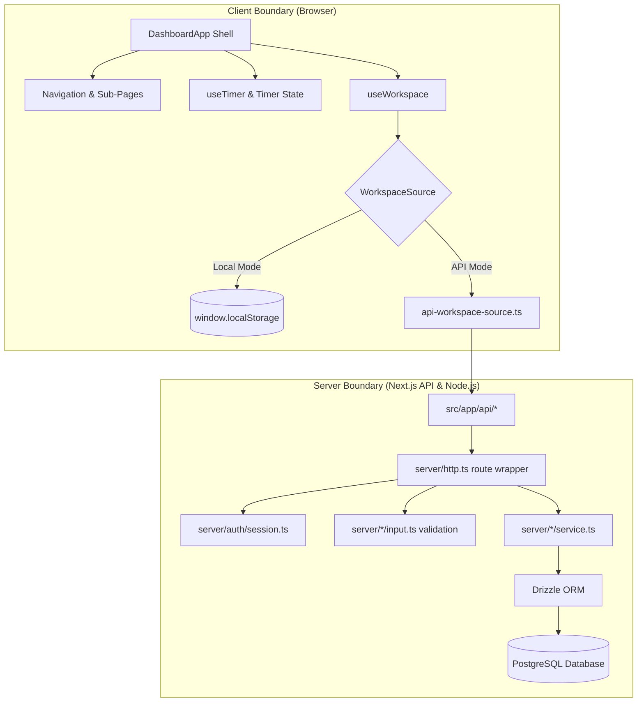

# Architecture

## High-Level Overview
OBLIQ-in is a private CA-firm workspace designed for Chartered Accountants, article assistants, reviewers, and client collaboration. The application adopts a unified Next.js App Router foundation with a dual-mode persistence architecture (client-local preview vs. backend Postgres API).



## Architectural Patterns

### 1. Persistent Dashboard Shell Pattern
- The root layout ([src/app/layout.tsx](file:///e:/Open%20Source/Obliq-in-app/src/app/layout.tsx)) mounts a persistent `<DashboardApp />`.
- Sub-routes (e.g. `/[section]/page.tsx`) pass their slug to the dashboard shell, which mounts the appropriate screen component dynamically.
- **Benefit**: Retains ephemeral states (such as active time-tracking session and drawer/modal inputs) across URL navigations without requiring global state management dependencies (Redux, Zustand, MobX).

### 2. WorkspaceSource Adapter Pattern
- Defined in [src/types/workspace.ts](file:///e:/Open%20Source/Obliq-in-app/src/types/workspace.ts):
  ```ts
  type WorkspaceSource = {
    load: () => Promise<WorkspaceData>;
    create: (kind: ModalKind, values: FormValues) => Promise<WorkspaceData>;
    saveTime: (project: string, seconds: number) => Promise<WorkspaceData>;
  };
  ```
- Two interchangeable implementations:
  1. `createLocalWorkspace`: Pure browser storage backed by fallback fixtures in `data/dashboard.ts`.
  2. `createApiWorkspace`: RESTful client calling Next.js route handlers.

### 3. Server Isolation & Three-Tier Backend
- The `src/server/` module uses the `server-only` package to guarantee that database connections, secrets, and server queries never leak into client bundles.
- Request Pipeline:
  1. **HTTP Layer** (`src/server/http.ts`): Wraps route handlers, executes authentication checks, catches uncaught exceptions, and returns normalized JSON errors.
  2. **Validation Layer** (`src/server/*/input.ts`): Applies Zod schemas to sanitize and parse JSON payloads.
  3. **Service Layer** (`src/server/*/service.ts`): Enforces multi-tenant data boundaries by scoping all database queries to `session.firmId`.
  4. **Mapper Layer** (`src/server/*/mappers.ts`): Maps SQL records to frontend data contracts.

### 4. Tenant Isolation & Authorization Invariants
- `firm_id` is never accepted as an untrusted parameter from the request body or URL params; it is strictly derived from the validated `FirmSession`.
- Invitations and role management enforce strict row-level verification before granting membership or modifying resources.
